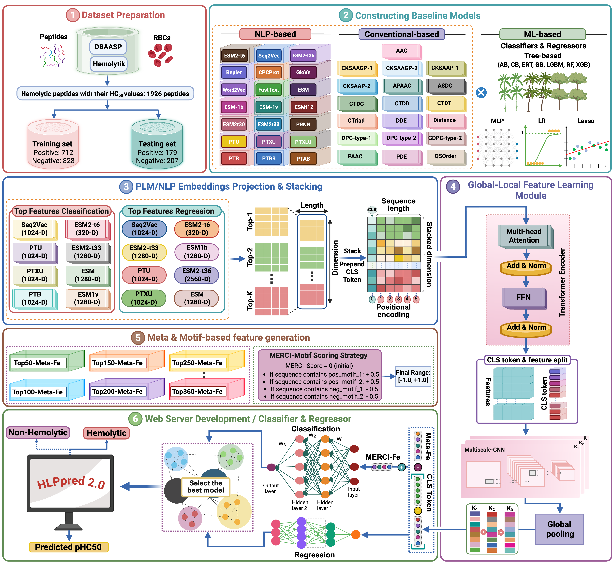

<h1 align="center">HLPpred 2.0</h1>
<p align="center"><a href="https://balalab-skku.org/HLPpred2/">🌐 Webserver (CBBL-SKKU)</a> | <a href="https://zenodo.org/records/23474229">🚩 Models</a></p>

<p align="center">
<a href="https://github.com/sangarajukumar/HLPpred2/stargazers"></a>
<a href="https://github.com/sangarajukumar/HLPpred2/network/members"></a>
<a href="https://github.com/sangarajukumar/HLPpred2/blob/main/LICENSE"></a>
<a href="https://doi.org/10.5281/zenodo.23474229"></a>
</p>

The official implementation of **HLPpred 2.0: An Interpretable Hybrid Deep Learning Framework for Hemolytic Peptide Classification and Hemolytic Activity Prediction**

> [!IMPORTANT]
> **Supplementary material** (Fig. S1-S11 and Table S1-S8) is provided in this repository:
> [Supplementary figures](supplementary_figures/supplementary_figures.pdf) | [Supplementary tables](supplementary_tables/Supplementary_tables.pdf) | [Contents](#supplementary-material)

<p align="center"></p>

You can use HLPpred 2.0 with the <a href="https://balalab-skku.org/HLPpred2/">🌐 Webserver (CBBL-SKKU)</a> or follow the steps below to train or run the models locally.

## TOC

- [Supplementary material](#supplementary-material)
- [Installing environment](#installing-environment)
- [Preparing datasets](#preparing-datasets)
- [Configurations](#configurations)
- [Training models](#training-models)
- [Inferencing models](#inferencing-models)

## Supplementary material
The supplementary figures and tables of the manuscript are provided as PDF files:

| File | Contents |
|---|---|
| [supplementary_figures/supplementary_figures.pdf](supplementary_figures/supplementary_figures.pdf) | Fig. S1-S11 |
| [supplementary_tables/Supplementary_tables.pdf](supplementary_tables/Supplementary_tables.pdf) | Table S1-S8 |

<details>
<summary><b>Supplementary figures</b></summary>

| Figure | Description |
|---|---|
| S1 | Amino acid composition of HPs and non-HPs, and N-/C-terminal amino acid preferences |
| S2 | Two-sample logo analysis of positional amino acid preferences (N- and C-terminal 15 residues) |
| S3 | Classification MCC of nine ML classifiers on 21 PLM/NLP embeddings and 19 conventional descriptors |
| S4 | Regression RMSE of nine ML regressors on the same features |
| S5 | Classification meta-models with Top50-Top360 meta-feature sets |
| S6 | Regression meta-models with Top50-Top360 meta-feature subsets |
| S7 | Classification performance of Top-1 to Top-8 embeddings with Top300 Meta-Fe and MERCI-Fe |
| S8 | Regression performance of Top-1 to Top-8 embeddings with Top360 Meta-Fe |
| S9 | Sequence identity between the training and independent datasets |
| S10 | pHC50 distributions of the training and independent datasets |
| S11 | Probability calibration and precision-recall analysis on the independent dataset |

</details>

<details>
<summary><b>Supplementary tables</b></summary>

| Table | Description |
|---|---|
| S1 | The 21 PLM/NLP embeddings and 19 conventional descriptors with their dimensions |
| S2 | Parameter search ranges for training HLPpred 2.0 |
| S3 | Comparison with existing hemolytic peptide predictors on the complete independent dataset (N = 386) |
| S4 | Comparison with existing predictors on method-specific non-overlapping independent subsets |
| S5 | Inference time, throughput and memory usage at different batch sizes |
| S6 | Stage-wise computational cost for a batch of 386 peptides |
| S7 | Performance of the 360 single-feature baseline models, classification |
| S8 | Performance of the 360 single-feature baseline models, regression |

</details>

## Installing environment
Tested on Ubuntu 24.04 with Python 3.9, PyTorch 1.13.1 (CUDA 11.7 build) and an NVIDIA L40S GPU (driver 570, CUDA 12.8). A GPU is recommended; the full pipeline also runs on CPU with `--device cpu` (3 sequences took about 8 minutes on a 128-thread server, mostly loading the models).

First, install [Miniconda](https://docs.anaconda.com/miniconda/) or [Conda](https://docs.conda.io/projects/conda/en/latest/user-guide/getting-started.html).
Then create and activate the environment:

```bash
git clone https://github.com/sangarajukumar/HLPpred2.git
cd HLPpred2
conda env create -f environment.yml
conda activate hlppred2
```
Next, install the required dependencies:
```bash
python -m pip install --no-deps -r requirements.txt --no-cache-dir
```
Finally, clone the ESM repository, which provides the ESM-2 models:
```bash
git clone https://github.com/facebookresearch/esm.git tools/esm
```

## Preparing datasets

The training and independent test sets are deposited in datasets/ (classification: `Training.fasta`, `Independent.fasta`; regression: `Training_reg.fasta`, `Independent_reg.fasta`). Training also requires the per-residue SeqVec embeddings, the meta features of the base models and the MERCI scores; their paths are set in the configuration below.

## Configurations
The configurations are in training/classification/config.yaml and training/regression/config.yaml.
There are some parameters you should concentrate on:
```bash
dataset:
  train_fasta_path: /path/to/Training.fasta
  test_fasta_path: /path/to/Independent.fasta
  train_data_root: /path/to/train_embeddings # directory with the SeqVec embeddings
  test_data_root: /path/to/test_embeddings
  probs_file_path_train: /path/to/train_meta_features.txt # meta features of the base models
  probs_file_path_test: /path/to/test_meta_features.txt
  merci_file_path_train: /path/to/train_merci_scores.txt
  merci_file_path_test: /path/to/test_merci_scores.txt
  max_length: 39
...
trainer:
  batch_size: 8
  device: cuda # or cpu
  epochs: 100
  lr: 0.0001
  n_splits: 5
  output_path: /path/to/save_results # mention path to save results
```

## Training Models
To reconstruct the results from the paper, run the following commands to train the classification and regression models:
```bash
cd training/classification
python train.py --config_path config.yaml

cd ../regression
python train.py --config_path config.yaml
```

## Inferencing models
Download the models from <a href="https://zenodo.org/records/23474229">Zenodo</a> (4.9 GB). The ML archives are split into parts, so the script below downloads all files, verifies the checksums, joins the parts and extracts everything into `models/`:
```bash
bash download_models.sh models
```
Alternatively, download the files manually into `models/`, then join and extract them:
```bash
cd models
cat HLPpred2_classification_ML.zip.part* > HLPpred2_classification_ML.zip
cat HLPpred2_regression_ML.zip.part* > HLPpred2_regression_ML.zip
for f in HLPpred2_*.zip; do unzip -q "$f"; done
```
The directory should look like this:
```
models/
├── HLPpred2_classification_ML/   # 300 base models
├── HLPpred2_classification_DL/   # 5 fold checkpoints
├── HLPpred2_classification_woMERCI_DL/   # 5 fold checkpoints (without MERCI feature)
├── HLPpred2_regression_ML/       # 360 base models
└── HLPpred2_regression_DL/       # 5 fold checkpoints
```
Then predict directly from a FASTA file (standard amino acids, 1-39 residues). Features are extracted from the sequences, scored by the base models and passed to the deep learning models:
```bash
python predict.py --fasta example.fasta --models_dir models --output predictions.csv
```
The first run downloads the pretrained language models (about 60 GB).

| Option | Description |
|---|---|
| `--task` | `classification`, `classification_wo_merci` (without the MERCI feature), `regression` or `both` (classification + regression, default) |
| `--device` | `cuda` or `cpu` (default: `cuda` if available) |
| `--models_dir` | directory with the extracted models (default: `models/`) |
| `--esm_dir` | clone of the ESM repository (default: `tools/esm`) |

The output CSV contains `hemolytic_probability`, `predicted_class`, `merci_score`, `predicted_pHC50` and `predicted_HC50_uM` for every sequence (pHC50 = 6 - log10 HC50 [µM]).
